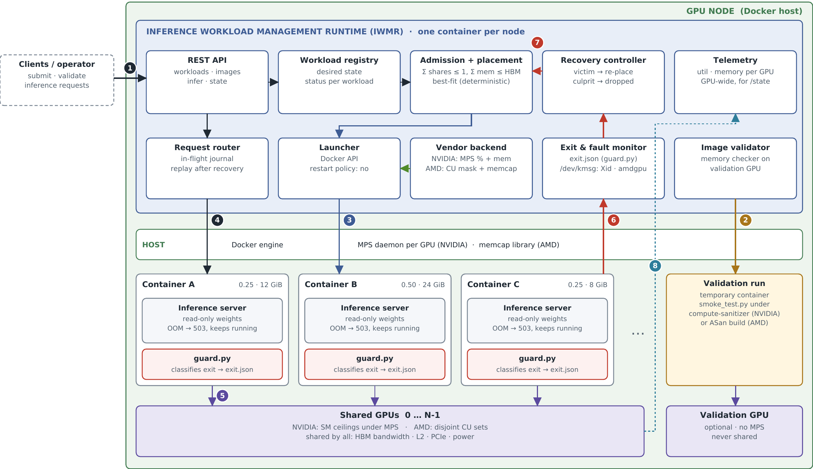
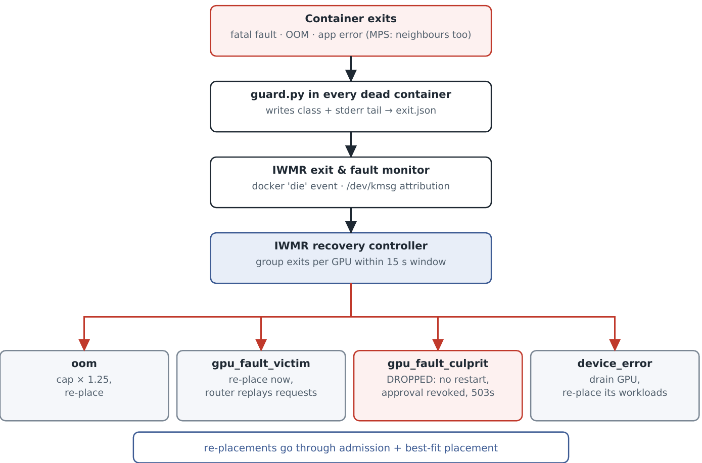

<h1> Partita</h1>

**Fine-grained GPU sharing for containerised inference, on NVIDIA and AMD.**

Partita runs several inference models in Docker containers on the same physical GPU. Each container gets a fixed
slice of the GPU (a compute share and a memory cap). Everything that manages those containers runs in one container
per GPU node, the **Inference Workload Management Runtime (IWMR)**: it admits and places workloads, starts them with
the right limits, routes inference requests to them, notices when they fail, and recovers them.

On NVIDIA GPUs the slices are enforced by the Multi-Process Service (MPS). On AMD GPUs they are enforced by
compute-unit (CU) masking and a small memory-cap library. The IWMR, the API and the container contract are the same
for both.

> **Status:** reference implementation for the COGAC testbed (ISI / Athena Research Center). The code compiles and
> the runtime logic has been exercised offline with Docker and the GPUs simulated. It has **not yet been run on GPU
> hardware**; see [Testing](#-testing) for the acceptance procedure.

---

## Contents

- [Why](#-why)
- [Architecture](#-architecture)
- [How a workload runs](#-how-a-workload-runs)
- [NVIDIA and AMD](#-nvidia-and-amd)
- [Faults and recovery](#-faults-and-recovery)
- [Repository layout](#-repository-layout)
- [Requirements](#-requirements)
- [Quick start](#-quick-start)
- [API](#-api)
- [Workload request](#-workload-request)
- [Inference container contract](#-inference-container-contract)
- [Configuration](#-configuration)
- [Testing](#-testing)
- [Limitations](#-limitations)
- [Documentation](#-documentation)
- [Icon credits](#icon-credits)

---

##  Why

A single inference model rarely needs a whole GPU, but giving each model its own GPU is the default. Sharing a GPU
between models raises three problems:

1. **Each model needs a guaranteed slice.** Without limits, one model can take all compute or all memory.
2. **Sharing weakens isolation.** Co-located models share memory bandwidth and caches, and under NVIDIA MPS a fatal
   GPU error in one model ends every model on that GPU.
3. **Someone has to manage it.** Placement, limits, restarts and request handling must happen without an operator.

Partita addresses these with ceilings enforced by the vendor's sharing mechanism, a capacity ledger that turns those
ceilings into effective reservations, validation of images before they may share a GPU, and a recovery controller
that drops the workload that caused a fault and brings back the ones that were only affected by it.

Placement is deliberately simple: **deterministic best-fit**. There is no learned or "smart" scheduler; the same
request on the same node state always lands on the same GPU.

---

##  Architecture



One GPU node contains:

| Part | Where | What it does |
|---|---|---|
| **IWMR** | one container | The only management component. Contains the ten modules below. |
| Host services | host | Docker engine. On NVIDIA also one MPS control daemon per GPU (systemd). On AMD the memory-cap library file. |
| Inference containers | host Docker | One model each, wrapped by `guard.py`, which records why the container exited. |
| Shared GPUs | hardware | Run the inference containers within their slices. |
| Validation GPU | hardware, optional | Kept out of sharing; used only to check images before approval. |

Modules inside the IWMR:

| Module | File | Responsibility |
|---|---|---|
| REST API | `runtime/runtime.py` | Single entry point for clients and operators. |
| Workload registry | `runtime/runtime.py` | Desired state and status of each workload. |
| Admission + placement | `runtime/ledger.py` | Admit only if the GPU still has share and memory; choose the GPU by best-fit. |
| Launcher | `runtime/runtime.py` | Start and stop inference containers through the host Docker socket. |
| Vendor backend | `runtime/backends/` | Translate a share and memory cap into container settings for NVIDIA or AMD. |
| Request router | `runtime/router.py` | Forward inference requests; keep them in a journal until answered; replay after recovery. |
| Exit & fault monitor | `runtime/runtime.py`, `runtime/faults.py` | Read each container's exit classification; attribute GPU faults from the kernel log. |
| Recovery controller | `runtime/recovery.py` | Apply fixed recovery rules to every exit. |
| Telemetry | `runtime/telemetry.py` | Sample utilisation and memory per GPU. |
| Image validator | `runtime/validator.py` | Run an image's smoke test under a memory checker on the validation GPU. |

Each node runs its own IWMR. Nodes do not coordinate; to use several nodes, put an ordinary load balancer in front of
their APIs.

---

##  How a workload runs

1. **Validate the image.** `POST /images/validate` runs the image's `/app/smoke_test.py` on the validation GPU under a
   memory checker. A clean run adds the image digest to the approved list.
2. **Register the workload.** `POST /workloads` with the image, its digest, a compute share (0–1) and a memory cap.
   Only approved digests may share a GPU; anything else must use `isolation: exclusive` (alone on a GPU).
3. **Admit and place.** The ledger lists the GPUs where the new share and memory still fit:
   - the sum of compute shares on a GPU stays at or below 1;
   - the sum of memory caps, plus each container's context overhead, stays within GPU memory;
   - the per-GPU client limit and exclusivity are respected.

   Best-fit then picks the GPU that would be left with the least free share (ties: lowest index).
4. **Launch.** The vendor backend produces the container settings and the launcher starts the container on a private
   Docker network, with restart policy `no`. The IWMR polls the container's `/health` until it is ready.
5. **Serve.** Clients send `POST /workloads/{id}/infer` to the IWMR. The router forwards each request to the
   container, keeps it in the journal until the response returns, and retries after OOM back-pressure.
6. **Exit.** When a container stops for any reason, `guard.py` has already written the cause to `exit.json`. The IWMR
   releases the slice and hands the exit to the recovery controller.

Limits are fixed when a container starts. Changing a workload's slice means restarting it.

---

##  NVIDIA and AMD

| | NVIDIA | AMD |
|---|---|---|
| Sharing mechanism | MPS, one control daemon per GPU | Concurrent hardware queues, no daemon |
| Compute slice | `CUDA_MPS_ACTIVE_THREAD_PERCENTAGE`: a ceiling on the share of SMs; the hardware picks which SMs | `HSA_CU_MASK`: a specific, disjoint range of CUs chosen by the backend |
| Memory cap | `CUDA_MPS_PINNED_DEVICE_MEM_LIMIT`, enforced by the driver | `libhipmemcap.so` (this repository), preloaded into the container |
| Image check | `compute-sanitizer` on the unmodified image | AddressSanitizer build of the image |
| Fault reach | MPS tears down every client on that GPU | Normally only the faulting process; a GPU reset affects all |
| Hard partitions (optional) | MIG, with MPS inside a slice | CPX/DPX compute + NPS memory partitions (MI300 and newer) |
| Telemetry | `nvidia-smi` | sysfs (`gpu_busy_percent`, `mem_info_vram_used`) |

What neither vendor isolates when sharing: memory bandwidth, L2 / Infinity Cache, PCIe and the power budget.
Co-located models can slow each other down. Latency-critical models should run with `isolation: exclusive` or on a
hardware partition.

---

##  Faults and recovery



Every inference container runs behind `guard.py`, which watches the server's error output and classifies its exit:

| Class | Typical evidence | Recovery |
|---|---|---|
| `oom` | CUDA/HIP out of memory, `[hipmemcap] denied` | Re-place with a 25 % larger memory cap (bounded by GPU memory) |
| `gpu_fault_culprit` | illegal memory access, misaligned address, memory access fault; or the kernel log names the process | **Dropped**: not restarted, image approval revoked, pending requests answered with 503 |
| `gpu_fault_victim` | MPS client terminated | Re-placed immediately; the router replays its pending requests |
| `device_error` | GPU reset, launch timeout, uncorrectable ECC | GPU drained (taken out of service), workloads re-placed |
| `app_error` / `unknown` | anything else | Treated as a victim if the same GPU had a culprit in the last 15 s; otherwise restart with back-off, at most 5 times |
| `ok` / `stopped` | exit 0, SIGTERM | None |

Exits on the same GPU within 15 seconds form one **incident**; this is how the workload that caused a fault is told
apart from the workloads that were only affected by it.

A dropped workload's image can return to a shared GPU only after it passes validation again.

Out-of-memory at the cap is not fatal: the inference server answers `503` with `Retry-After`, halves its batch size and
keeps running. Fatal GPU faults cannot be recovered in place, because the GPU context is gone; model weights are
reloaded from disk and the only state carried over is the request journal.

---

##  Repository layout

```
gpushare/
├── README.md
├── docs/
│   ├── GPU_Sharing_Architecture_Overview.pdf
│   ├── GPU_Sharing_Technical_Implementation_Guide.pdf
│   ├── architecture.png
│   └── fault-handling.png
├── deploy/
│   ├── setup_nvidia_node.sh      persistence + EXCLUSIVE_PROCESS mode, one MPS daemon per GPU
│   ├── nvidia-mps@.service       systemd template unit (instance = GPU index)
│   ├── setup_amd_node.sh         builds libhipmemcap.so, prints CU/XCC/VRAM inventory
│   ├── run_runtime.sh            creates the Docker network and starts the IWMR
│   └── example_request.json      example workload registration
├── runtime/                      the IWMR container
│   ├── Dockerfile
│   ├── runtime.py                API, registry, launcher, exit and health watchers
│   ├── ledger.py                 admission and best-fit placement
│   ├── router.py                 request router and in-flight journal
│   ├── recovery.py               recovery rules
│   ├── faults.py                 kernel-log fault monitor
│   ├── telemetry.py              per-GPU sampling
│   ├── validator.py              image validation
│   └── backends/                 base.py, nvidia.py, amd.py
├── container/                    what goes into every inference image
│   ├── guard.py                  error catcher (entrypoint wrapper)
│   ├── oom_handling.py           recoverable OOM in the server
│   ├── hipmemcap.c               AMD memory-cap library
│   ├── smoke_test_template.py    inputs used during validation
│   └── Dockerfile.example
└── tests/
    ├── gpu_lowlevel.py           ctypes access to libcuda / HIP (no PyTorch needed)
    ├── mps_sm_count.py           SM count visible under MPS
    ├── mps_burn.py               concurrent compute load, NVIDIA
    ├── hip_burn.py               concurrent compute load, AMD
    ├── mem_cap_test.py           checks the memory cap
    └── fault_inject.py           triggers an illegal memory access (testbed only)
```

---

##  Requirements

| | NVIDIA | AMD |
|---|---|---|
| GPU | Volta or newer | CDNA (MI100 / MI200 / MI300); partitions need MI300 or newer |
| Driver | CUDA 11.5 or newer (for the MPS memory limit) | ROCm 6.x or 7.x |
| Container runtime | Docker + nvidia-container-toolkit | Docker |
| Host tools | systemd, `nvidia-cuda-mps-control` | gcc (to build the memory-cap library), `amd-smi` (optional) |
| Image validation | CUDA toolkit on the host (`compute-sanitizer`) | ASan build of each image |

The IWMR image itself is `python:3.12-slim` with `fastapi`, `uvicorn`, `docker`, `requests` and `anyio`. It
contains no CUDA or ROCm libraries.

---

##  Quick start

### NVIDIA

```bash
# 1. host: one MPS daemon per GPU; GPU 3 kept for validation (optional)
sudo cp deploy/nvidia-mps@.service /etc/systemd/system/ && sudo systemctl daemon-reload
sudo VALIDATION_GPU=3 ./deploy/setup_nvidia_node.sh

# 2. build and start the IWMR
docker build -f runtime/Dockerfile -t iwmr:latest .
sudo VENDOR=nvidia VALIDATION_GPU=3 ./deploy/run_runtime.sh

# 3. check
curl -s localhost:8080/state | python3 -m json.tool
```

### AMD

```bash
# 1. host: build the memory-cap library, show the inventory
sudo ./deploy/setup_amd_node.sh

# 2. build and start the IWMR
docker build -f runtime/Dockerfile -t iwmr:latest .
sudo VENDOR=amd ./deploy/run_runtime.sh
```

### First workload

```bash
# validate the image (requires a validation GPU)
curl -s -X POST localhost:8080/images/validate \
     -H 'Content-Type: application/json' -d '{"image": "registry.local/infer/llama-8b:1.4"}'
curl -s localhost:8080/images/validate/<job>            # wait for "approved"

# register, use, remove
curl -s -X POST localhost:8080/workloads -H 'Content-Type: application/json' -d @deploy/example_request.json
curl -s -X POST localhost:8080/workloads/llm-a-001/infer -H 'Content-Type: application/json' -d '{"inputs": [[1, 2, 3]]}'
curl -s -X DELETE localhost:8080/workloads/llm-a-001
```

The IWMR needs privileged access to the host: the Docker socket, the host process list (`--pid host`) and the kernel
log (`/dev/kmsg`). `deploy/run_runtime.sh` sets these, and the technical guide explains each one. Access to the Docker
socket is equivalent to root on the host, so do not expose the API outside a trusted network.

---

##  API

Interactive documentation is served at `http://<node>:8080/docs`.

| Method and path | Purpose |
|---|---|
| `POST /workloads` | Register and place a workload. `403` if a shared workload's image is not approved; `503` with the reason for each GPU if nothing fits. |
| `GET /workloads` | All workloads with status, GPU, slice and restart count. |
| `GET /workloads/{id}` | One workload in full. |
| `DELETE /workloads/{id}` | Stop gracefully; the slice is released when the container exits. |
| `POST /workloads/{id}/infer` | Inference request through the router. Optional `X-Request-ID` header as idempotency key. |
| `POST /images/validate` | Start a validation run for an image. Returns a job id. |
| `GET /images/validate/{job}` | Validation status (`running`, `approved`, `rejected`, `error`) and log tail. |
| `GET /state` | Per GPU: health, share used, memory reserved, utilisation, memory used, unexpected use; in-flight requests; recent recovery events. |
| `POST /gpus/{g}/undrain` | Return a drained GPU to service after inspection. |
| `GET /health` | Liveness of the IWMR. |

Workload status values: `starting`, `ready`, `unhealthy`, `recovering`, `dropped`, `failed`, `stopped`.

---

##  Workload request

```json
{
  "workload_id": "llm-a-001",
  "image": "registry.local/infer/llama-8b:1.4",
  "image_digest": "registry.local/infer/llama-8b@sha256:<digest>",
  "compute_share": 0.25,
  "mem_bytes": 12884901888,
  "isolation": "shared",
  "port": 8000,
  "infer_path": "/infer",
  "env": { "MODEL_PATH": "/models/model.pt", "MAX_BATCH": "32" },
  "volumes": { "/srv/models/llama-8b": "/models" }
}
```

| Field | Required | Meaning |
|---|---|---|
| `workload_id` | yes | Unique name; the container is called `gs-<workload_id>`. |
| `image` | yes | Inference image. |
| `image_digest` | for shared placement | Must be on the approved list. |
| `compute_share` | yes | Fraction of one GPU, 0–1. NVIDIA: rounded up to a whole percentage, then by MPS to whole TPCs. AMD: rounded up to an even number of CUs. |
| `mem_bytes` | yes | Device-memory cap. |
| `isolation` | no | `shared` (default) or `exclusive` (alone on a GPU; no validation needed). |
| `port`, `infer_path` | no | Where the server listens. Defaults: `8000`, `/infer`. |
| `env`, `command` | no | Passed to the container. |
| `volumes` | no | Host path → container path, always mounted read-only. |

---

##  Inference container contract

Any inference image works if it:

1. uses `guard.py` as its entrypoint, wrapping the real server
   (`ENTRYPOINT ["python3", "/opt/gpushare/guard.py", "--"]`);
2. contains `/app/smoke_test.py`, which exercises the input shapes used in production (see
   `container/smoke_test_template.py`);
3. reads model weights from a read-only volume;
4. exposes `GET /health`, and answers out-of-memory with `503` and `Retry-After` instead of crashing
   (see `container/oom_handling.py`).

The image never sets its own GPU limits. The IWMR injects them when it starts the container. `container/Dockerfile.example`
shows a complete image.

---

##  Configuration

IWMR environment variables (set by `deploy/run_runtime.sh` or passed with `-e`):

| Variable | Default | Meaning |
|---|---|---|
| `GPUSHARE_VENDOR` | `nvidia` | `nvidia` or `amd`. |
| `GPUSHARE_NETWORK` | `gpushare` | Docker network shared by the IWMR and the inference containers. |
| `VALIDATION_GPU` | unset | GPU index kept out of sharing for image validation. Unset: validation unavailable. |
| `CTX_OVERHEAD_MB` | `512` | Memory each container uses outside its cap. Measure it for your GPU model. |
| `COMPUTE_HEADROOM` | `0.0` | Share of each GPU kept free (e.g. `0.1`). |
| `MAX_CLIENTS_PER_GPU` | `48` | MPS client limit (Volta-class GPUs; check your CUDA version). |
| `READY_TIMEOUT_S` | `600` | How long a new container may take to pass `/health`. |
| `SANITIZER_DIR` | `/usr/local/cuda/compute-sanitizer` | Host path of `compute-sanitizer` (NVIDIA validation). |
| `VALIDATION_TIMEOUT_S` | `3600` | Maximum duration of one validation run. |

`run_runtime.sh` also reads `VENDOR`, `IMAGE` (default `iwmr:latest`) and `PORT` (default `8080`).

---

##  Testing

The scripts in `tests/` talk to the GPU driver directly through ctypes, so they need neither PyTorch nor a CUDA or
ROCm toolkit. Run them in this order on the testbed:

| # | Test | Command | Pass when |
|---|---|---|---|
| T1 | Full compute inventory | `CUDA_MPS_ACTIVE_THREAD_PERCENTAGE=100 python3 tests/mps_sm_count.py` / `setup_amd_node.sh` | Matches the GPU specification |
| T2 | Compute ceiling visible | `python3 tests/mps_sm_count.py 10 25 50 100` | SM count follows the percentage |
| T3 | Compute ceiling effective | `python3 tests/mps_burn.py 25 50 25` / `python3 tests/hip_burn.py 25 50 25` | Time per launch roughly inversely proportional to the share |
| T4 | Memory cap | `python3 tests/mem_cap_test.py nvidia\|amd` with a 2 GiB cap | Stops within one 256 MiB block of the cap |
| T5 | Container path | manual `docker run` from the technical guide, §4.3 | Same results as T2 and T4 |
| T6 | IWMR start-up | `run_runtime.sh`, then `GET /state` | All GPUs listed and healthy; validation GPU excluded |
| T7 | Validation | validate a clean and a faulty image | Clean approved, faulty rejected |
| T8 | Admission | submit workloads until full | Best-fit order; never over-committed; `503` with reasons |
| T9 | Fault reach | three burn clients, then `tests/fault_inject.py` on the same GPU | Record which processes die and their error text |
| T10 | Recovery | repeat T9 with IWMR-managed workloads | Culprit dropped and its image revoked; victims ready again; their requests answered |
| T11 | OOM path | oversized batches against a small cap | `503` while running; after an OOM exit, cap ×1.25 and re-placed |

T9 is the most important: the error text printed by the victims defines the patterns `guard.py` uses to recognise
them, and these differ between CUDA and ROCm versions.

---

##  Limitations

- **No bandwidth isolation.** Memory bandwidth and caches are shared on both vendors and best-fit placement does not
  account for them.
- **One IWMR per node, state in memory.** If the IWMR restarts, it removes its workload containers and starts clean;
  in-flight requests are lost and clients must retry.
- **Privileged runtime.** The IWMR holds the Docker socket and the host process namespace. The API has no
  authentication yet.
- **Culprit detection on NVIDIA** relies mainly on the error text of the failing process; the kernel log often names
  the MPS server rather than the client. A culprit that dies without a recognisable message is treated as a victim if
  it is part of an incident.
- **AMD memory cap coverage.** `hipMallocManaged`, `hipExtMallocWithFlags`, `hipMallocPitch` and functions resolved
  through `hipGetProcAddress` bypass `libhipmemcap.so`. Confirm T4 with the framework you actually use.
- **AMD CU layout.** On multi-die GPUs (MI300), the mapping from CU index to die must be checked before relying on the
  backend's die-local ranges.
- **Kernel hangs** trigger a GPU reset on both vendors, which ends every process on that GPU.
- **Static slices.** A running workload cannot be resized; it is restarted with the new slice.

---

##  Documentation

- [`docs/GPU_Sharing_Architecture_Overview.pdf`](docs/GPU_Sharing_Architecture_Overview.pdf): components, how they fit
  together, isolation and design decisions (5 pages).
- [`docs/GPU_Sharing_Technical_Implementation_Guide.pdf`](docs/GPU_Sharing_Technical_Implementation_Guide.pdf): host
  setup for both vendors, every script explained, API, acceptance tests and command reference.

---

## Icon credits

Section icons are from the **Data Center** pack by [surang](https://www.flaticon.com/authors/surang) on
[Flaticon](https://www.flaticon.com/packs/data-center), free for personal and commercial use with attribution.
Icons used: [Server](https://www.flaticon.com/free-icon/server_6621761),
[Processor](https://www.flaticon.com/free-icon/processor_6621716),
[Centralized](https://www.flaticon.com/free-icon/centralized_6621473),
[Funnel](https://www.flaticon.com/free-icon/funnel_6621584),
[Network switch](https://www.flaticon.com/free-icon/network-switch_6621670),
[Alert](https://www.flaticon.com/free-icon/alert_6621409),
[Database](https://www.flaticon.com/free-icon/database_6621526),
[Gear](https://www.flaticon.com/free-icon/gear_6621597),
[Hosting](https://www.flaticon.com/free-icon/hosting_6621625),
[Online](https://www.flaticon.com/free-icon/online_6621684),
[Computer](https://www.flaticon.com/free-icon/computer_6621498),
[Cabinets](https://www.flaticon.com/free-icon/cabinets_6621461),
[Search](https://www.flaticon.com/free-icon/search_6621747),
[Safety](https://www.flaticon.com/free-icon/safety_6621731),
[Firewall](https://www.flaticon.com/free-icon/firewall_6621569),
[Monitor](https://www.flaticon.com/free-icon/monitor_6621655).
